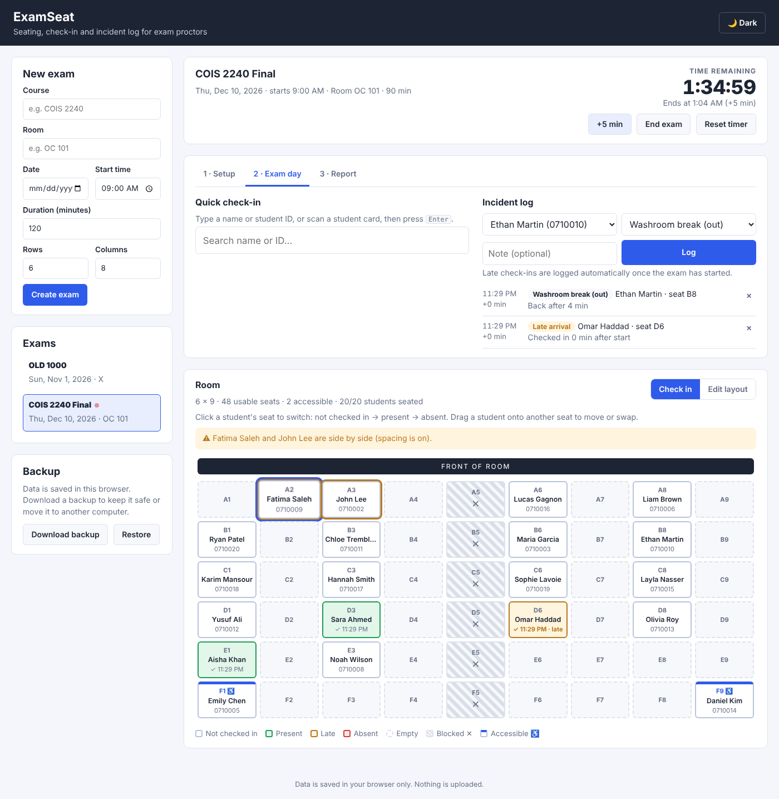

# ExamSeat


A web app for exam proctors: plan the room, auto-assign seats with real seating rules, check students in on exam day, run the exam timer and keep an incident log.

**Live demo:** https://abdel-thinat.github.io/examseat/



## Why I built it

I work as an exam proctor at my university. Seating charts, attendance and incident notes are often done on paper, which is slow and easy to get wrong. ExamSeat handles the whole exam in one place, from planning the room to exporting the final report.

## Features

### Setup
- **Multiple exams** with course, room, date, start time and duration
- **Student import**: paste a list or upload a CSV, and mark students who need an accessible seat
- **Room layout editor**: mark aisles or broken seats as blocked ✕, and mark accessible seats ♿
- **Seating rules**
  - optional spacing (no two students side by side)
  - **keep-apart pairs**: chosen students are never seated next to each other, including diagonally
  - students who need accessible seats always get one
- **Auto-assign** seats randomly while following every rule
- **Drag and drop** to move or swap students, with live warnings if a manual move breaks a rule

### Exam day
- **Exam timer** with live countdown, +5 min extensions, and colour warnings at 15 and 5 minutes left
- **Quick check-in**: type a name or ID, or scan a student card, and press Enter. The student's seat is highlighted
- **Automatic late-arrival logging** for anyone checked in after the exam starts
- **Incident log**: washroom breaks, early leaves, suspected misconduct, medical and more, with timestamps and minutes into the exam

### Report
- Live summary: present, late, absent, not checked in, incidents
- Export **attendance CSV** (in seat order) and **incident log CSV**
- Print-friendly seating chart (or save as PDF)

### General
- Dark mode (follows your system setting, with a manual toggle)
- Works on phones and tablets
- Data is saved in the browser (localStorage), with **backup and restore** to a JSON file
- Old (v1) data is upgraded automatically

## Tech

- HTML, CSS and vanilla JavaScript, with no frameworks and no build step
- **`js/core.js`**: all the logic as pure functions (seating algorithm, rules, timer, CSV, data migration). It has no DOM access, so it is unit-tested in Node
- **`js/app.js`**: the user interface (rendering, events, saving)
- **Tests**: 23 unit tests using Node's built-in test runner (`node:test`)
- **CI**: GitHub Actions runs the tests on every push and pull request
- **Hosting**: GitHub Pages

### How the seating algorithm works

1. Build the list of usable seats (blocked seats removed), front row first.
2. Shuffle the students with a Fisher–Yates shuffle, putting students who need accessible seats first.
3. Give each student the first free seat that breaks no rule (accessible seat, spacing, keep-apart).
4. If a student can't be placed, reshuffle and try again (up to 300 attempts). If it still fails, explain why.

The random number generator can be seeded, so the tests are repeatable.

## Project structure

```
examseat/
├── index.html
├── css/style.css
├── js/
│   ├── core.js          # logic (tested)
│   └── app.js           # user interface
├── tests/core.test.js
├── sample-students.csv
├── package.json
└── .github/workflows/ci.yml
```

## Run it locally

1. Download or clone this repository.
2. Open `index.html` in your browser. That's it.

To try it quickly, create an exam and upload `sample-students.csv`.

### Run the tests

Requires Node.js 20 or newer. No install step is needed.

```
npm test
```

## CSV format

```
Student ID,Name,Accessible
0710001,Sara Ahmed,
0710002,John Lee,yes
```

The header row and the third column are optional. `yes`, `y` or `A` in the third column means the student needs an accessible seat.

## Roadmap

- Java Spring Boot backend with a database, so several proctors can share an exam
- Proctor logins
- Rooms with custom shapes saved as reusable templates
- Touch-friendly drag and drop for tablets
